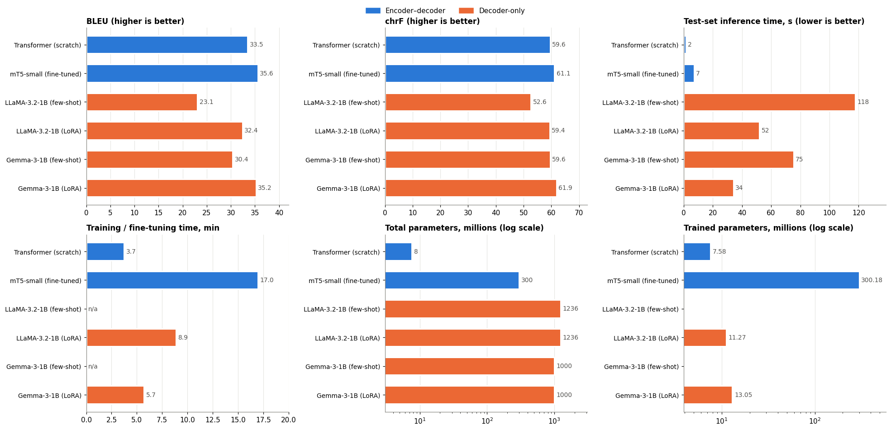

# English-to-German machine translation: encoder-decoder and decoder-only models

**ICT4403 Foundations of Generative AI · Assignment 3 · Steps 1–2**

## Problem and objective

Build four English-to-German translation systems—a basic Transformer, mT5, Llama, and Gemma—and compare translation quality, model size, training time, inference time, and responsible-AI risks on the same held-out examples. The [executed notebook](notebooks/ia3_machine_translation.ipynb) contains the implementation, output tables, plots, and analysis. The [assignment brief](IA3_ICT4403_FGAI_Final.pdf) gives the full requirements.

## Dataset and preprocessing

The parallel-text source is [Multi30k English–German](https://github.com/multi30k/dataset), also available through the [Hugging Face mirror used by the notebook](https://huggingface.co/datasets/bentrevett/multi30k). It contains image captions with English sentences and human German translations. The [Multi30K paper](https://aclanthology.org/W16-3210/) describes the data and its CC BY-NC-SA 4.0 license. The notebook uses text only, without the images.

The official splits contain 29,000 training, 1,014 validation, and 1,000 test pairs. The notebook normalizes Unicode and whitespace, removes empty and duplicate training pairs, removes training sources found in validation or test, and filters two length/ratio outliers. This leaves **28,994 training pairs**. It samples **500 test pairs** from the official test split with seed 42; all six evaluated systems use those exact 500 source/reference pairs. The Transformer uses the full cleaned training set; mT5 uses 15,000 sampled pairs; the LoRA models use 2,000 sampled pairs. Few-shot prompting uses three examples from training. These different budgets are a limit on architecture-level conclusions.

The selected [test split](results/split_test.csv) and all six full [translation files](results/README.md) are included. The notebook downloads the original data when rerun; bulk copies of the source corpus are not kept in Git.

## Models and method

| System | Architecture | Adaptation |
| --- | --- | --- |
| Basic Transformer | 3-layer encoder + 3-layer decoder, 256 hidden units, 8 heads, 8k joint BPE vocabulary | Trained from scratch |
| [mT5-small](https://huggingface.co/google/mt5-small) | Encoder-decoder | Full fine-tuning |
| [Llama 3.2 1B Instruct](https://huggingface.co/meta-llama/Llama-3.2-1B-Instruct) | Decoder-only | Three-shot prompting and LoRA fine-tuning |
| [Gemma 3 1B IT](https://huggingface.co/google/gemma-3-1b-it) | Decoder-only | Three-shot prompting and LoRA fine-tuning |

The LoRA runs train rank-16 adapters on attention and MLP projections, then merge them into the base weights for inference. The notebook uses greedy decoding, a maximum of 128 new tokens, the same 500 test rows, and corpus-level SacreBLEU BLEU and chrF for its main comparison. It counts all model parameters and trainable parameters separately. Its timing code warms the model and synchronizes CUDA before and after inference.

## Execution and dependencies

Open [the notebook](notebooks/ia3_machine_translation.ipynb) in Jupyter, Kaggle, or Colab with a CUDA GPU and run cells from top to bottom. The first setup cell installs the additional packages. The saved run used a **Tesla T4 (15.6 GB)**, PyTorch **2.11.0+cu128**, Transformers **4.57.6**, and SacreBLEU **2.6.0**. Other dependencies used in the notebook include `peft`, `accelerate`, `datasets`, `sentencepiece`, `protobuf`, `tokenizers`, `pandas`, `numpy`, `matplotlib`, and `requests`.

Set a private `HF_TOKEN` environment variable or a Kaggle/Colab secret for access to the [Llama](https://huggingface.co/meta-llama/Llama-3.2-1B-Instruct) and [Gemma](https://huggingface.co/google/gemma-3-1b-it) checkpoints, after accepting their model terms. The notebook also has mirror fallback IDs. Never paste a token into a notebook cell or commit one to Git. With `QUICK_RUN = False`, the notebook writes tables, plots, all translations, probe outputs, and training histories to `mt_outputs` and creates a ZIP at the end. The [curated results](results/README.md) here are from that completed run. Rerunning on another GPU may change timing and some scores.

## Results and comparison

All scores below were recomputed from the saved 500-row translation CSVs and match [`results.json`](results/results.json). Times are from the completed T4 run. Prompting has no training time.

| System | BLEU ↑ | chrF ↑ | Train min ↓ | Test inference s ↓ | Total params M |
| --- | ---: | ---: | ---: | ---: | ---: |
| Transformer (scratch) | 33.49 | 59.55 | 3.75 | **1.57** | 7.58 |
| mT5-small (fine-tuned) | **35.60** | 61.11 | 16.96 | 7.15 | 300.18 |
| Llama 3.2 1B (three-shot) | 23.06 | 52.62 | — | 117.61 | 1,235.81 |
| Llama 3.2 1B (LoRA) | 32.42 | 59.39 | 8.86 | 52.02 | 1,235.81 |
| Gemma 3 1B (three-shot) | 30.37 | 59.59 | — | 75.35 | 999.89 |
| Gemma 3 1B (LoRA) | 35.24 | **61.87** | 5.72 | 34.12 | 999.89 |

**mT5 is the best model by BLEU**, the primary metric here, and translates the full test set about 4.8 times faster than Gemma LoRA. Gemma LoRA has the highest chrF and is only 0.36 BLEU below mT5. The basic Transformer is fastest and smallest, at 7.58 million parameters. LoRA improves Llama by 9.36 BLEU and Gemma by 4.87 BLEU over their three-shot variants. The LoRA variants also have shorter prompts than the few-shot variants, so their inference-time advantage is not solely due to fine-tuning.

This is a comparison of **systems**, not a controlled test of architecture alone: model size, pretraining, tokenization, training subset, and adaptation method differ. The [tokenization table](results/tokenization.csv) and [quality-versus-cost plot](results/quality_vs_cost.png) help explain the trade-offs. BLEU and chrF use one reference and can miss valid alternatives or serious meaning errors.

## Sampling-temperature analysis

The reported translations use **greedy decoding** (`do_sample=False`), so each step selects the highest-probability next token; no sampling-temperature sweep was run. This keeps the quality and timing comparison deterministic. With sampling enabled, a temperature below 1 sharpens the next-token distribution, while a higher temperature makes lower-probability words more likely. For translation, that may create alternate valid phrasing but also raises the risk of dropped negation, changed numbers, additions, and wrong-language output. The saved scores support conclusions about the greedy setting only. **No scores for temperatures 0.7 or 1.0 are claimed.**

## Responsible-AI findings

The notebook includes 75 probes for gender, culture, idioms, sensitive content, and out-of-domain text. The [probe translations](results/README.md) show concrete limitations:

- **Gender bias:** On 18 gender-neutral occupation probes, Gemma LoRA chose a masculine form in 88.9% of outputs. In 36 pronoun-context probes, it followed the gender cue on 77.8% of pro-stereotypical cases but only 38.9% of anti-stereotypical cases. These are small, heuristic probe sets, not population estimates. The [gender plot](results/gender_bias.png) compares all systems.
- **Meaning and safety:** For “Do not take more than 4 tablets in 24 hours,” mT5 produced “Einige Tablets gehen in der Nacht etwas,” losing the instruction. The basic Transformer also produced unrelated text. Medical, legal, and dosage translations need qualified human review.
- **Culture and language drift:** The basic Transformer garbled a Diwali sentence, while Gemma LoRA answered an anti-immigrant sentence in Chinese instead of German. Several systems translated “It is raining cats and dogs” literally. These examples show why a good average score does not guarantee a faithful individual translation.

Suggested mitigations include balanced and counterfactual data, explicit handling of ambiguous gender, native-speaker review of cultural terms, automated checks for numbers/negation/entities, domain-aware quality estimation, and mandatory human post-editing for high-impact text. Preserve the original source alongside machine output and make correction possible. The notebook's heuristics flag candidates for review; they do not certify translation safety.

## Conclusion

For this Multi30k test set, **mT5-small is the best overall choice by BLEU and inference time among the two top-scoring systems**. Gemma LoRA leads on chrF; the basic Transformer offers the lowest compute cost. The ranking should not be generalized beyond this dataset and run without testing other domains and human adequacy judgments.
